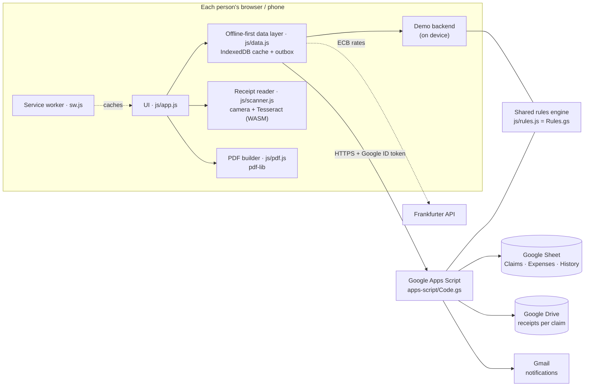

# Escola Europea · Expense Claims

> This repository uses the **flat layout**: every file sits in the root folder (easy to upload through the GitHub website).

An installable web app for expense claims at Escola Europea – Intermodal Transport: scan receipts with the camera, have them read on the device, send the claim for approval, and download a PDF with every receipt attached.

**Live demo:** publish this folder on GitHub Pages and open it. Until the Google service is configured, the app runs in **demo mode**: everything stays in the browser and a "View as" selector lets you play claimant, manager and administration.

> Setup guide in Spanish: **[GUIA_INSTALACION.md](GUIA_INSTALACION.md)**

## What it does

| | |
|---|---|
| 📷 **Receipt scanner** | Camera capture (phone or webcam), automatic compression, and on-device OCR (Tesseract, self-hosted) that fills in date, amount, currency, supplier and receipt number. |
| 💱 **Exchange rates** | One click for the official ECB reference rate on the expense date. |
| 📴 **Works offline** | Installable PWA. Drafts and receipts are kept on the device (IndexedDB) and synced in order when the connection returns. |
| ✅ **Approval workflow** | Draft → manager approval → administration → settled, with return-for-changes. Permissions and transitions are enforced by the server. |
| ✉️ **Automatic emails** | Branded emails at every step via Gmail, with a link to the claim. |
| 🗂 **Records** | Every claim, expense line and event is written to a Google Sheet; receipts are filed in a Drive folder per claim. |
| 📄 **PDF with receipts** | Built on the device: summary, category totals, expense table, approval history, signature boxes, then every receipt (photos and PDF pages). |
| 🔔 **Alerts** | App badge and desktop notifications when a claim needs you. |

## Architecture



- **One rules engine, two runtimes.** `js/rules.js` holds validation, permissions, transitions, totals and email content. The browser loads it directly; `tools/build-gas.mjs` copies it to `apps-script/Rules.gs`. The server is always the authority.
- **Identity.** Users sign in with Google. Every request carries a Google ID token that the backend verifies (audience = this app's OAuth client, verified email, allowed Workspace domain).
- **Data access.** A claim is visible only to its claimant, its manager and its administrator. Revision numbers prevent silent overwrites.
- **No external processing of receipts.** OCR and PDF generation run on the user's device; libraries are vendored in `vendor/`.

## Project layout

```
index.html, manifest.webmanifest, sw.js   App shell, PWA manifest, service worker
css/app.css                               Escola Europea visual identity
js/config.js                              ← the only file to edit when connecting Google
js/rules.js                               Shared rules engine (browser + Apps Script)
js/app.js                                 User interface
js/data.js, js/store.js                   Offline-first data layer (IndexedDB, outbox, sync)
js/backends.js, js/auth.js                Google Apps Script client, demo backend, Google Sign-In
js/scanner.js, js/rates.js, js/pdf.js     Camera + OCR, ECB rates, PDF builder
apps-script/                              Code.gs, Rules.gs (generated), appsscript.json
vendor/                                   Tesseract.js, pdf-lib, Inter font (with licences)
tests/                                    Rules tests, Apps Script emulator and backend tests
```

## Development

Requires Node.js 20+ for the tests; the app itself has no build step.

```bash
npm test               # rules engine + real Code.gs against emulated Google services
npm run build:gas      # regenerate apps-script/Rules.gs after editing js/rules.js
npm run serve          # http://localhost:8080 (demo mode)
```

When you change the app, bump `VERSION` in `sw.js` so installed copies update.

## Licences

Application code © Escola Europea – Intermodal Transport. Third-party: Tesseract.js and tesseract.js-core (Apache-2.0), pdf-lib (MIT), Inter (SIL OFL 1.1). Licence texts are in `vendor/`.
